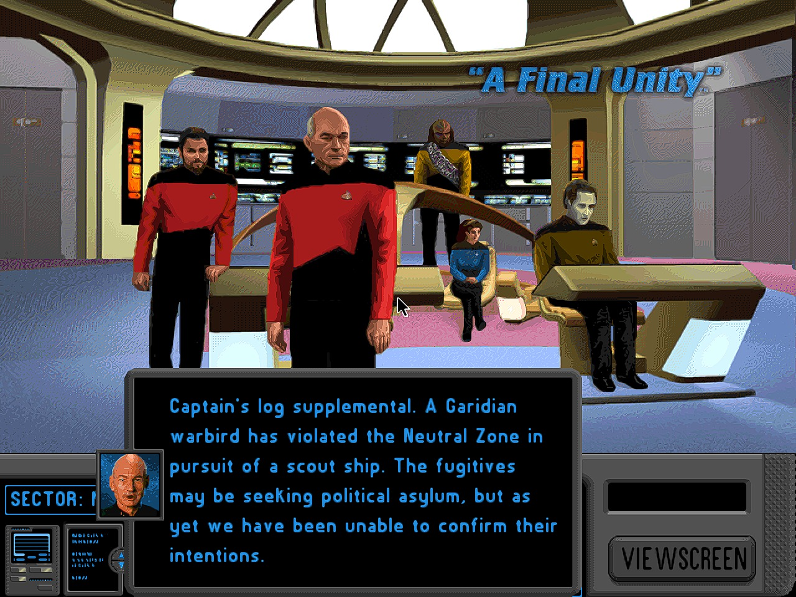
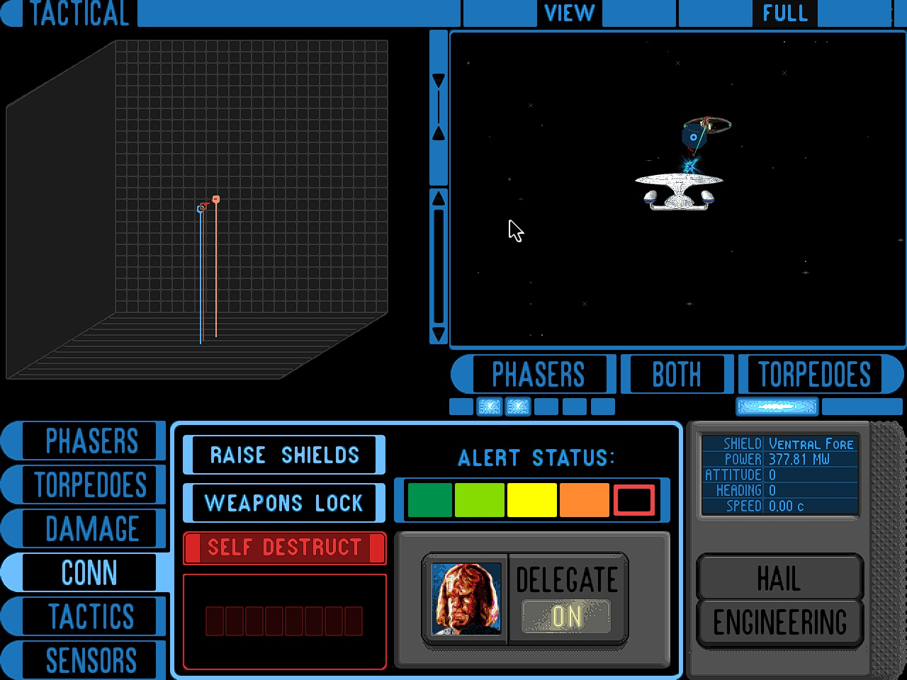
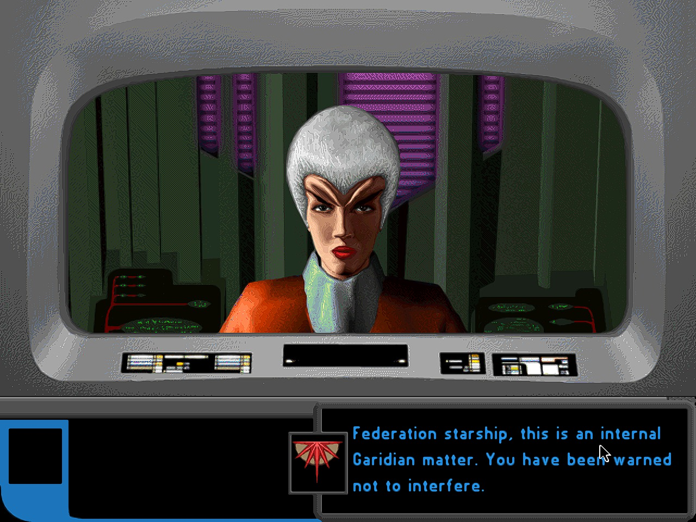
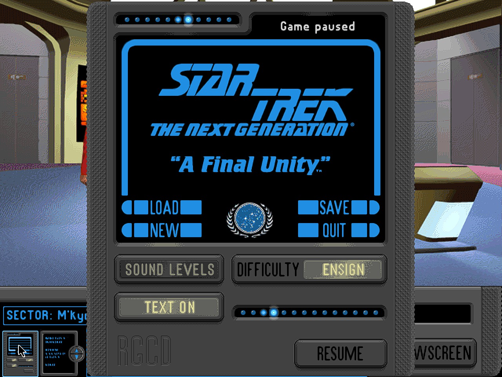
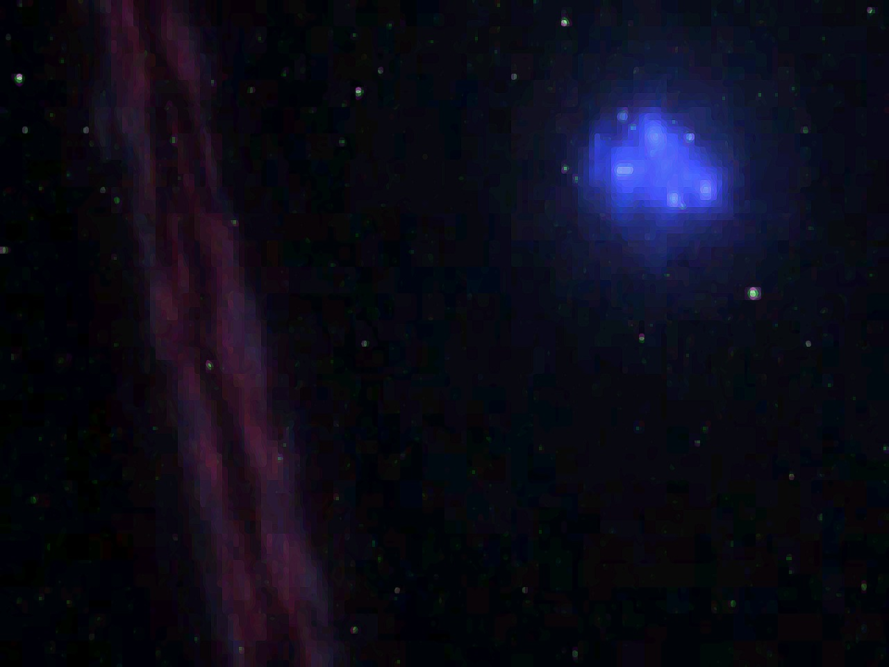
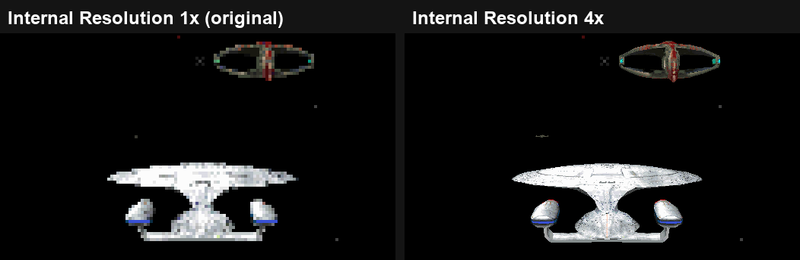
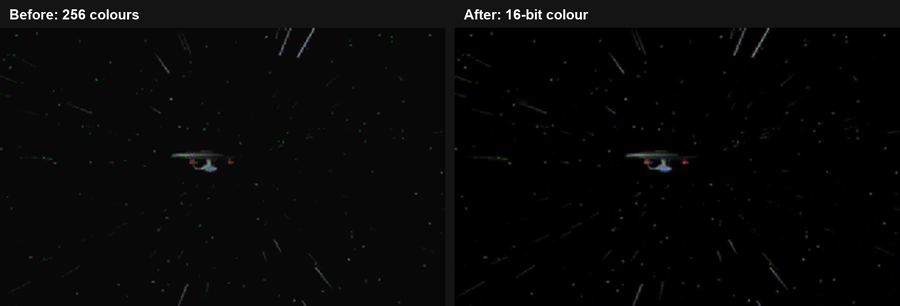

# Star Trek: The Next Generation – "A Final Unity" – PC Native

A native Windows version of *Star Trek: The Next Generation – "A Final Unity"* (Spectrum HoloByte, 1995, DOS).
No DOSBox: the game's own code is converted from x86 machine code to C by a static recompiler and runs on a
small PC runtime that replaces DOS, the DOS/4GW extender, the BIOS, the VESA video card and the Sound Blaster
with Windows services.

**This repository contains no game files.** You need your own copy of the game (the CD version).



## Screenshots

| | |
|---|---|
|  |  |
| Tactical, 3D rendered at 4x | Hailing the Garidian warbird |
|  |  |
| The pause panel (RGCD) | Intro movie, full size, 16-bit colour |

### Internal Resolution: the 3D is rendered again at 4x



### Movies: 256 colours (DOS) vs 16-bit colour (this port)



Same frames of the intro movie side by side ([video, sharper](docs/media/movies_256_vs_16bit.mp4)).
Left: the DOS game's 256-colour playback. Right: the same movie decoded in 16-bit colour, as this port
plays it - smooth shading, no colour banding, true black space.

## What's new compared to DOS

- **Real higher resolution for the 3D space scenes** – Video > Internal Resolution: 2x (1280x960),
  3x (1920x1440, 2K), 4x (2560x1920). The tactical and combat views are rendered again at that size,
  not just scaled up.
- **Full-size movies in 16-bit colour** – the FVF movies fill the window instead of a small box, and are
  decoded with 65,536 colours instead of the 256-colour palette (no banding, true black space).
  Both can be switched off in the Video menu.
- **Upscaling and presentation** – xBR upscale filter, sharpening, FXAA, 4:3 / stretch / integer scaling,
  widescreen zoom, any window size, Alt+Enter fullscreen.
- **Sound** – the game's HMI SOS sound system replaced by a native mixer (music, speech, effects, movie sound).

## Installing

1. Download **`Star Trek The Next Generation - A Final Unity PC Setup.exe`** from
   [Releases](../../releases).
2. Run it and point it at your game CD: the disc, an image (`.iso`, `.bin`/`.cue`, `.nrg`) or a folder
   with a copy of the CD. Choose a folder and press Install.
3. Start the game from the Start menu or desktop shortcut.

The setup copies the CD (about 660 MB) and makes the hard-disk part of the game the way the DOS installer
did. Nothing is downloaded. An uninstaller is included (Apps & features).

**Options** (menu bar of the game window, or `sttng_pc.ini`): Internal Resolution 1x-4x (4x default),
full-size and 16-bit colour movies (on), space combat frame rate (18 fps default: the enemy AI steering
was made for 1990s frame rates, higher rates make enemy ships shake), upscale filter, sharpening,
aspect ratio, widescreen. Alt+Enter switches fullscreen.

## Status

Work in progress (v0.1). Tested so far: intro and title movies, the bridge, the viewscreen, Tactical and
space combat, hailing, the pause panel (RGCD), saving. Not tested yet: away missions, loading, the full
story.

## Building

Windows Python 3 with capstone + Pillow, MSYS2 MINGW64 (gcc, SDL2), Ghidra for the function lists.
The port is made with the Dos tools kit (`dosport.py`).

1. Copy the game CD to `gamedata/cd/` and put `STTNG.OVL` from `STTNGINS.ZIP` there too.
2. Make the installed game in `game/hd/` (the files of `STTNGINS.ZIP` plus the "optimal" install from
   `STTNG.ZIP`, see the `*.LST` files on the CD) and link `game/cd` to `gamedata/cd`.

```bash
python dosport.py ghidra     # function lists -> re/sttng/ (functions.tsv is in the repo)
./build.sh gen               # recompile + build sttng.exe
./run_test.sh 30             # hidden test run (switches: ST_SHOT=ms, ST_KEYS=..., ST_CLICK=x,y,ms, ST_HRSHOT=ms)
```

## Layout

| Path | What |
|---|---|
| `src/rt/` | the PC runtime: DOS, DPMI, BIOS, VESA, mouse, timer/keyboard, Direct3D 9 presenter, settings |
| `src/rt/native_sound.c` | HMI SOS 4 digital sound API on an SDL mixer |
| `src/game/hires.c` | the N x render of the 3D library (viewport switch, merge, presenter layer) |
| `src/game/movies.c` | full-size 16-bit movies |
| `tools/recomp.py`, `tools/x86an.py` | x86 -> C recompiler and code analysis |
| `tools/native_sttng.txt` | game functions replaced by native C |
| `tools/subst_sttng.txt` | game constants made runtime values for the N x pass |
| `re/sttng/functions.tsv` | Ghidra's function list of the game |

Fan preservation project, not affiliated with Paramount or the game's publishers.
Star Trek and related marks are trademarks of their owners.
